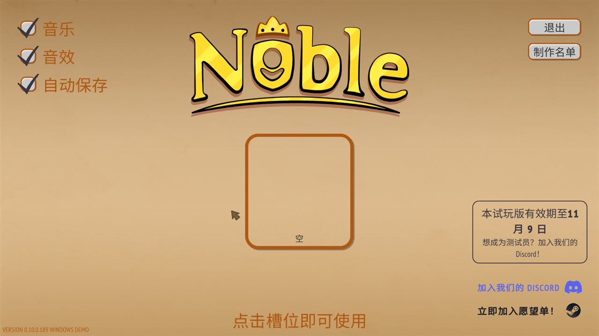

# Noble 简体中文汉化（Noble Demo）

[English](README_EN.md)

为 Extra Nice 出品的《Noble》Steam 试玩版（**Noble Demo，Unity 2022.3 / Mono，Windows x64**）制作的简体中文汉化补丁，以及用到的工具与技术笔记。



## 下载补丁

到 **[Releases](https://github.com/ljgit428/noble-cn/releases)** 下载，提供两种包：

| 包 | 内容 | 适合 |
|---|---|---|
| `Noble_CN_Patch_vX_Installer.zip` | xdelta 差异补丁 + `Install.bat` / `Uninstall.bat`。**不含任何原版或修改后的游戏文件**；安装时逐个校验 MD5，用你本地的正版文件现场生成汉化版，版本不符直接停止 | 推荐 |
| `Noble_CN_Patch_vX_Overwrite.zip` | 已打好补丁的完整文件，解压到游戏根目录直接覆盖；不做版本校验 | 想省事、且确认游戏版本一致 |

适用游戏版本：**0.10.0.189 WINDOWS DEMO**（标题画面左下角）。游戏更新后需等待补丁适配。

安装后首次启动会多等几秒（BepInEx 初始化 + 生成中文字体图集）。

## 汉化范围

- 事件标题 / 说明 / 结果文本（约 1.1 万条）、UI、教程、头衔、家族信息与背景、好感 / 声望等级、属性与标签、游戏结束画面
- 程序内硬编码的 UI 字符串（年份、确认框、保存 / 载入、继承顺位、家族统计等）
- 人名音译，头衔与地名意译
- **有意保留原文**：制作名单与 Patreon 赞助者人名、工作室名 Extra Nice

已知问题：
- 个别由代码拼接的片段（如属性需求里的 "or higher"）可能偶见英文
- 中文比英文短，少数按钮 / 长句排版略松

## 版权说明

- 《Noble》的文本、代码与资源版权归 **Extra Nice** 所有；本项目为玩家自制、免费、与官方无关，请购买 / 下载正版游玩。
- **本仓库只包含自写的工具代码、脚本与技术笔记，不包含任何游戏文件、游戏文本（英文原文或中文译文）、反编译代码或打好补丁的文件。**
- 代码以 MIT 协议发布（见 `LICENSE`）。中文字体为思源黑体 Source Han Sans CN（Adobe，SIL OFL 1.1）。

## 技术方案

1. **资源级汉化**：用 [AssetsTools.NET](https://github.com/nesrak1/AssetsTools.NET) + Mono.Cecil 从 `Managed\*.dll` 生成 MonoBehaviour 类型树（游戏剥离了类型树），把译文直接写回 `level0/1/2`、`resources.assets`、`sharedassets0/1.assets` 中 MonoBehaviour 的字符串字段。
2. **中文字体**：把思源黑体嵌入 `resources.assets` 里的 `LiberationSans` Font 资源（PathID 147）；再由 BepInEx 插件 `NobleCN.FontFix` 在运行时用它 `TMP_FontAsset.CreateFontAsset(...)` 生成 2048×2048 动态 SDF 字体，并挂为所有 TMP 字体的全局 fallback。
3. **DLL 字符串**：用 Mono.Cecil 按映射表替换 `Noble.Core / Gameplay / UI / ScreenTitle.dll` 中的用户字符串。
4. **发布**：xdelta3 差异 + MD5 清单；安装脚本校验 → 备份到 `Noble_Data\_cn_backup` → 打补丁 → 装 BepInEx 与插件。

踩坑记录见 [docs/status.md](docs/status.md)（第五节）与 [docs/dev-notes.md](docs/dev-notes.md)。

## 仓库内容

```
install.ps1 / restore.ps1     开发用：把 work\ 里的构建产物装进游戏 / 从 backup\ 还原
tools/
  NobleCN.Tools/              noblecn.exe（.NET 8）：dump / apply / set-font / set-field / get-field / dll-strings / dll-apply
  build.bat                   一键重建：刷新原版 → 写入译文 → 注入字体 → 打 DLL → 校验
  build_release.py            生成 Installer 与 Overwrite 两种发布包
  release/                    发布包里的安装 / 卸载脚本与 README
  fetch_deps.ps1              下载 BepInEx 5.4.23.5、xdelta3 3.1.0、思源黑体（不入库）
  fonts/                      字体 LICENSE（字体本体由 fetch_deps.ps1 下载）
  *.ps1 / *.py / *.bat        截图、点击、验证、分析用的零散脚本
  scratch/                    早期合并 / 扫描脚本
plugin/NobleCN.FontFix/       BepInEx 插件源码（Harmony + TextMeshPro）
docs/                         汉化状态、工作记录、截图
```

不入库（`.gitignore`）：`backup/`（原版游戏文件）、`work/`（dump、译文、构建产物）、`release_build/`、所有 `.assets / .dll / .zip / .otf`。

## 构建流程

环境：Windows 10/11，.NET SDK 8+，Python 3.10+，Steam 版 Noble Demo。

```bat
:: 0) 依赖
powershell -ExecutionPolicy Bypass -File tools\fetch_deps.ps1
cd tools\NobleCN.Tools && dotnet build -c Release && cd ..\..
cd plugin\NobleCN.FontFix && dotnet build -c Release && cd ..\..   :: csproj 里的 GameManaged / BepInExCore 路径按需修改

:: 1) 把原版 6 个资源文件复制到 backup\original\，4 个 DLL 复制到 backup\original_dll\
:: 2) 准备译文（本仓库不含）：work\patch\apply_input.json / apply_final.json / apply_missing.json
::    每条 {"file","pathId","field","cls","text"}；DLL 映射 work\trans2\dll_map.json {"英文": "中文"}
:: 3) 构建 + 安装 + 验证
tools\build.bat
powershell -ExecutionPolicy Bypass -File install.ps1

:: 4) 发布包
python tools\build_release.py v0.1
```

## 致谢

原作：Extra Nice《Noble》。
[AssetsTools.NET](https://github.com/nesrak1/AssetsTools.NET)、[UABEA](https://github.com/nesrak1/UABEA)（classdata.tpk）、[BepInEx](https://github.com/BepInEx/BepInEx)、[HarmonyX](https://github.com/BepInEx/HarmonyX)、[xdelta](https://github.com/jmacd/xdelta)、[Source Han Sans](https://github.com/adobe-fonts/source-han-sans)。

## ❤️ 支持作者

汉化与校对完全出于个人热爱，本补丁永久免费开源。如果补丁改善了您的游戏体验，欢迎通过爱发电请作者喝杯咖啡 ☕：

* **爱发电主页**：[https://afdian.com/a/yukikaze_studio](https://afdian.com/a/yukikaze_studio)
